# Results of the manuscript

This page collects the numerical results of the accompanying manuscript
(in preparation). The numbers are read from `results/*.json` and the
figures from `figures/` in the
[repository](https://github.com/Raydonal/hierarchical-depth). Both are
produced by the Python pipeline of the repository with fixed seeds
(`make results figures`, about 13 minutes). `htheoryR` implements the
same estimators; [Recovering the depth of a
cascade](https://raydonal.github.io/hierarchical-depth/articles/identifiability.md)
runs them in R on simulated data.

## The model

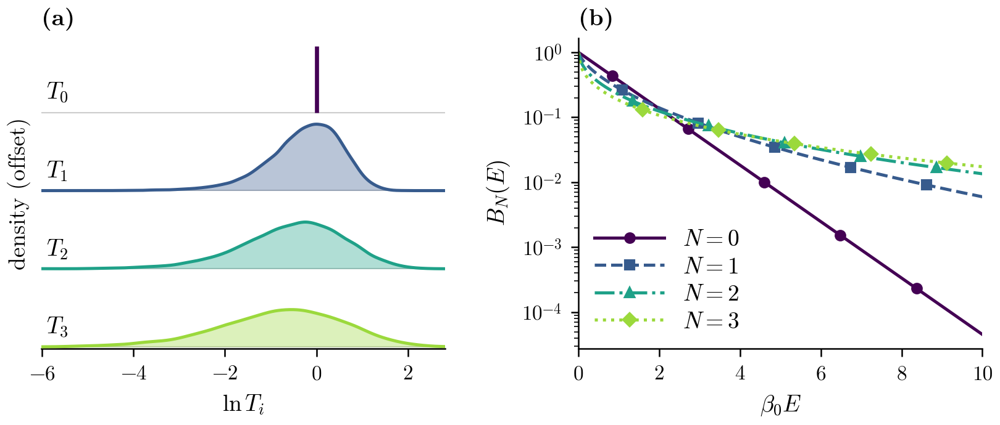

**Figure 1.** The cascade and its statistical factor in the class s =
1/2. (a) Densities of log T\_(i) for i = 0, …, 3, from simulated chains
with a\_(i) = 2 and T₀ = 1, offset vertically. (b) Statistical factor
B\_(N)(E) for N = 0, …, 3 at a = 1, on a logarithmic vertical scale.
Deeper cascades decay faster near E = 0 and more slowly in the tail.

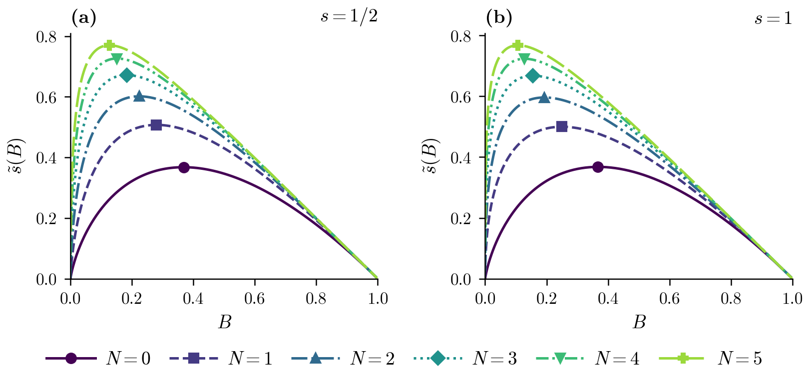

**Figure 2.** Entropy generator plotted against the statistical factor B
for N = 0, …, 5 and a = 1: (a) class s = 1/2; (b) class s = 1. The
marker on each curve indicates its maximum. All curves are concave, and
at fixed B the generator increases with N.

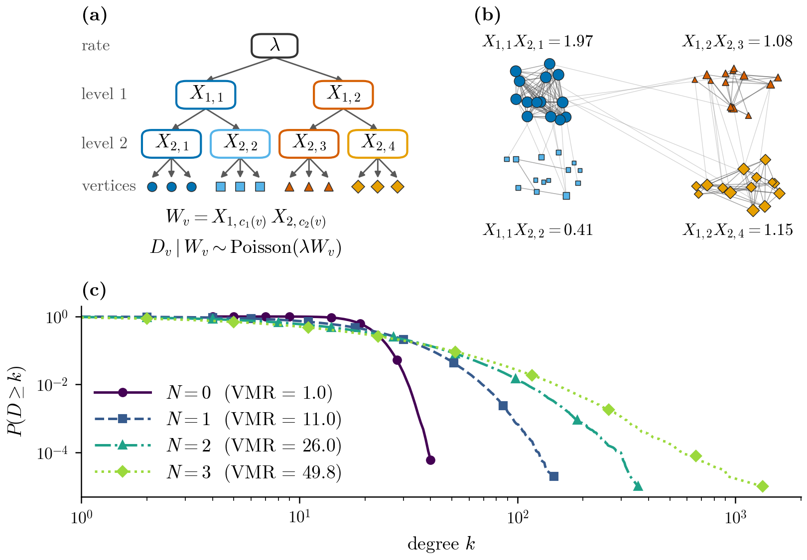

**Figure 4.** Hierarchical mixed-Poisson model. (a) Generative hierarchy
for N = 2: the propensity W\_(v) of a vertex is the product of the
factors of its communities, and its degree is Poisson with mean λW\_(v).
(b) One realized graph with N = 2. (c) Complementary cumulative degree
distributions of 10⁵ simulated vertices for N = 0, …, 3 (s = 1/2, a = 2,
λ = 20). Depth increases the dispersion of the degrees, which is the
information used by the estimator.

## Simulation: size and power of the depth test

The bootstrap test of \(H_{0}:N = 1\) was applied to samples from
cascades of depth \(N_{\text{true}} \in \{ 1,2,3,5\}\) (class
\(s = 1/2\), \(a = 2\)), with 100 samples per cell and 200 bootstrap
replicates per test. The row \(N_{\text{true}} = 1\) is the size of the
test (nominal level 0.05); the other rows are its power.

| True depth |   n = 100    |   n = 300    |   n = 1000   |   n = 5000   |
| :--------: | :----------: | :----------: | :----------: | :----------: |
|     1      | 0.02 (0.014) | 0.04 (0.020) | 0.04 (0.020) | 0.09 (0.029) |
|     2      | 0.18 (0.038) | 0.56 (0.050) | 0.97 (0.017) | 1.00 (0.000) |
|     3      | 0.36 (0.048) | 0.82 (0.038) | 1.00 (0.000) | 1.00 (0.000) |
|     5      | 0.65 (0.048) | 0.98 (0.014) | 1.00 (0.000) | 1.00 (0.000) |

Rejection rate of H0: N = 1 (Monte Carlo standard error).

Rejection rate of the test of H0: N = 1 against the sample size, by true
depth, read from results/compute\_article\_numbers.json. Bars are +/-
1.96 Monte Carlo standard errors; the dashed line is the nominal level
0.05.

The closed-form log-cumulants were checked against a large sample of an
unequal-shape cascade (\(a = (1.5,3,0.7)\), \(n = 4,000,000\)):

| cumulant | simulated | closed\_form |
| :------- | --------: | -----------: |
| kappa\_2 |    4.1629 |       4.1638 |
| kappa\_3 |  \-7.4353 |     \-7.4179 |
| kappa\_4 |   27.6398 |      27.4072 |

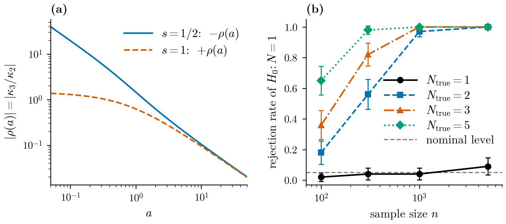

**Figure 3.** (a) Absolute log-cumulant ratio κ₃/κ₂ against the
homogeneous shape a; the ratio is negative for s = 1/2 and positive for
s = 1, and for s = 1 it is bounded by 2ζ(3)/ζ(2) ≈ 1.46. (b) The
rejection rates of the table above, as in the manuscript.

## Data sets

| Network       | Vertices | Edges | Density | Mean degree | Transitivity | Assortativity |
| :------------ | -------: | ----: | ------: | ----------: | -----------: | ------------: |
| email-Eu-core |      986 | 16064 |  0.0331 |        32.6 |        0.267 |      \-0.0257 |
| OpenFlights   |     3330 | 19079 | 0.00344 |        11.5 |        0.249 |      \-0.0103 |
| C. elegans    |      279 |  2287 |   0.059 |        16.4 |        0.213 |      \-0.0927 |

Descriptive statistics of the three networks as simple undirected graphs
(isolated vertices removed).

  - **email-Eu-core**
    ([SNAP](https://snap.stanford.edu/data/email-Eu-core.html)): e-mail
    exchanges in a European research institution. The degree analysis
    keeps all 1005 vertices of the directed graph, including those of
    degree zero.
  - **OpenFlights**
    ([OpenFlights](https://github.com/jpatokal/openflights)): airports
    and the routes between them.
  - ***C. elegans*** ([WormAtlas](https://www.wormatlas.org/)): the
    hermaphrodite connectome; chemical synapses and gap junctions, each
    gap junction counted once.
  - **Turbulence** ([Mendeley
    Data](https://data.mendeley.com/datasets/xy8ggx9hn6/1)): hot-wire
    velocity in the wake of a 50 mm cylinder, Re = 5.17 × 10⁴, sampled
    at 1000 Hz, 2¹⁷ values. The analysis uses squared velocity
    increments at lags of 2 to 100 ms.

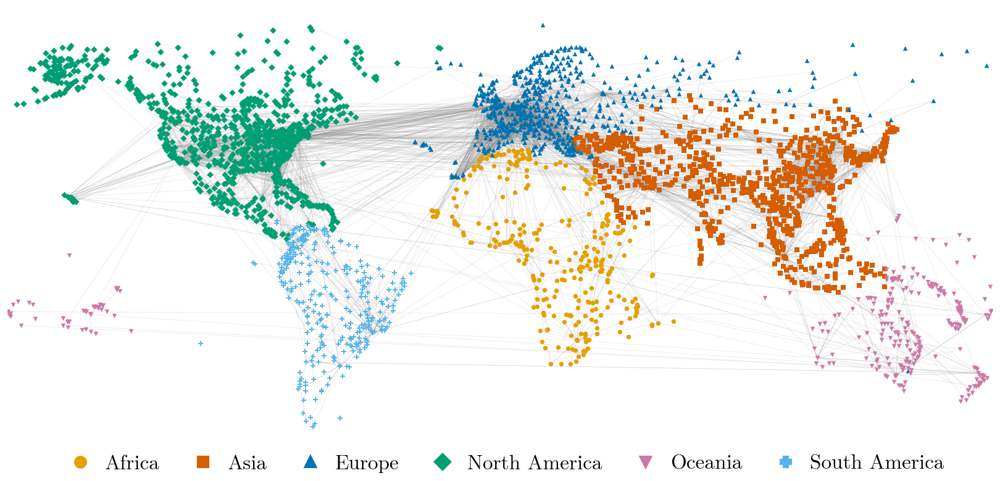

**Figure 5a.** OpenFlights: airports at their geographic position,
colored by continent, with a random sample of 6000 routes.

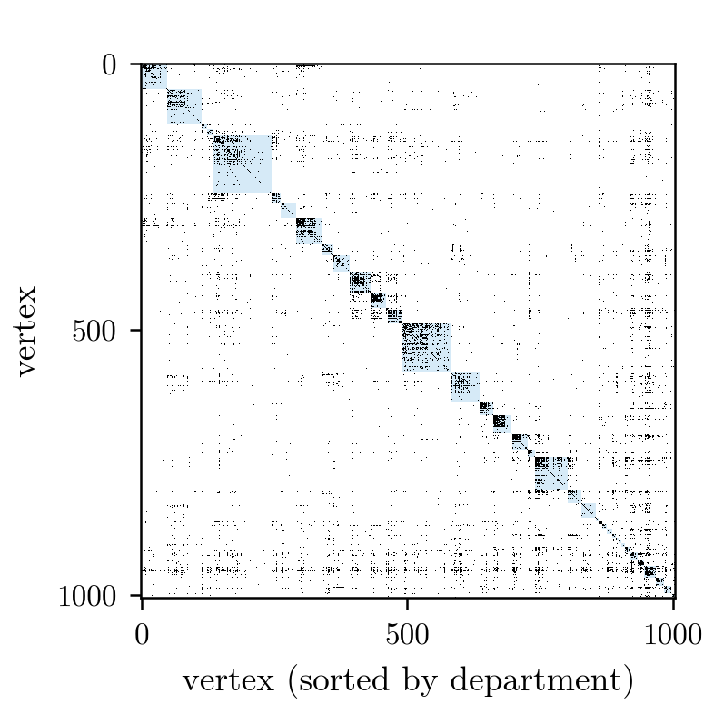

**Figure 5b.** email-Eu-core adjacency matrix, vertices sorted by
department; pairs within the same department (42 blocks) are shaded.

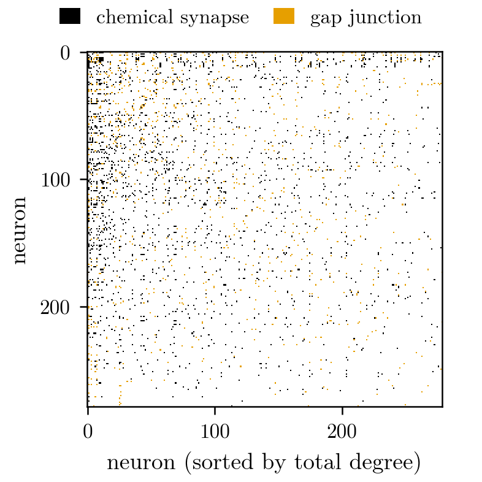

**Figure 5c.** *C. elegans* adjacency matrix, neurons sorted by total
degree; chemical synapses in black and gap junctions in orange. The
estimator uses only the degree sequences of the three networks.

## Estimates for the networks

For each degree series, only one class is admissible (the sign of the
log-cumulant ratio of the mixing law excludes the other). The table
gives the point estimates of \(a\) and \(N\) with 95% percentile
intervals from 1000 bootstrap resamples of the vertices, the rounded
depth \(N_{\text{rd}}\), and the \(p\)-value of the bootstrap test of
\(H_{0}:N = N_{\text{rd}}\). Because \(N_{\text{rd}}\) is chosen from
the same data, that \(p\)-value is a goodness-of-fit diagnostic, not a
confirmation of the depth.

| System        | Series |    n |  VMR |  s  |     â | 95% CI (a)  |    N̂ | 95% CI (N) | N rd |     p |
| :------------ | :----- | ---: | ---: | :-: | ----: | :---------- | ----: | :--------- | :--: | ----: |
| email-Eu-core | out    | 1005 | 43.6 | 1/2 | 0.768 | 0.396–1.27  |  1.18 | 0.731–1.75 |  1   | 0.391 |
| email-Eu-core | in     | 1005 | 30.7 | 1/2 | 0.802 | 0.555–1.13  | 0.956 | 0.727–1.24 |  1   | 0.825 |
| email-Eu-core | total  | 1005 |   71 | 1/2 | 0.825 | 0.495–1.29  |  1.09 | 0.743–1.58 |  1   | 0.645 |
| OpenFlights   | out    | 3315 |  144 | 1/2 | 0.216 | 0.126–0.333 |  1.21 | 0.93–1.53  |  1   | 0.194 |
| OpenFlights   | in     | 3321 |  144 | 1/2 | 0.215 | 0.127–0.334 |   1.2 | 0.938–1.54 |  1   | 0.193 |
| OpenFlights   | total  | 3330 |  288 | 1/2 | 0.212 | 0.125–0.317 |   1.2 | 0.92–1.5   |  1   | 0.193 |
| C. elegans    | out    |  253 | 16.7 | 1/2 |  8.06 | 1.03–61     |  4.13 | 0.57–28.4  |  4   | 0.989 |
| C. elegans    | in     |  268 | 42.5 | 1/2 |  1.09 | 0.409–1.81  |  1.55 | 0.667–2.23 |  2   | 0.770 |
| C. elegans    | total  |  279 | 51.6 |  1  |  7.55 | 3.92–134    |  4.77 | 1.85–98.8  |  5   | 0.995 |

Depth estimates with 95% bootstrap intervals for the nine degree series
(logarithmic axis), read from results/analyze\_\*.json. The dashed line
marks N = 1.

  - **email-Eu-core and OpenFlights.** Every series selects \(s = 1/2\)
    with \(N_{\text{rd}} = 1\), and every interval for \(N\) contains
    one: a single gamma mixing level, that is, negative-binomial
    degrees, describes both networks. A single level is a description of
    the degree law, not evidence of a one-level hierarchy.
  - ***C. elegans.*** The three series disagree (different rounded
    depths, and the total degree selects the other class), and the
    intervals are wide. With about 250 to 280 neurons, the data do not
    determine the depth.

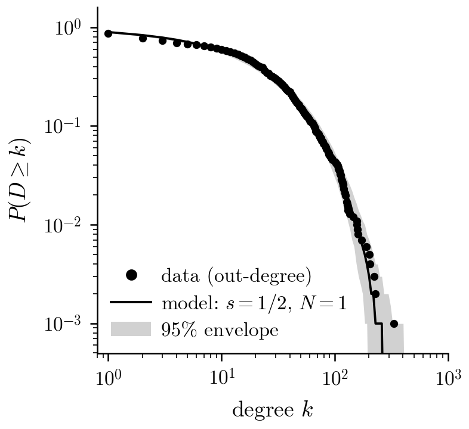

**Figure 6a.** email-Eu-core, out-degree: empirical complementary
cumulative degree distribution (markers) and the fitted mixed-Poisson
model at the tested null hypothesis (line: pointwise median; band: 95%
envelope over 500 simulated degree sequences of the same size).

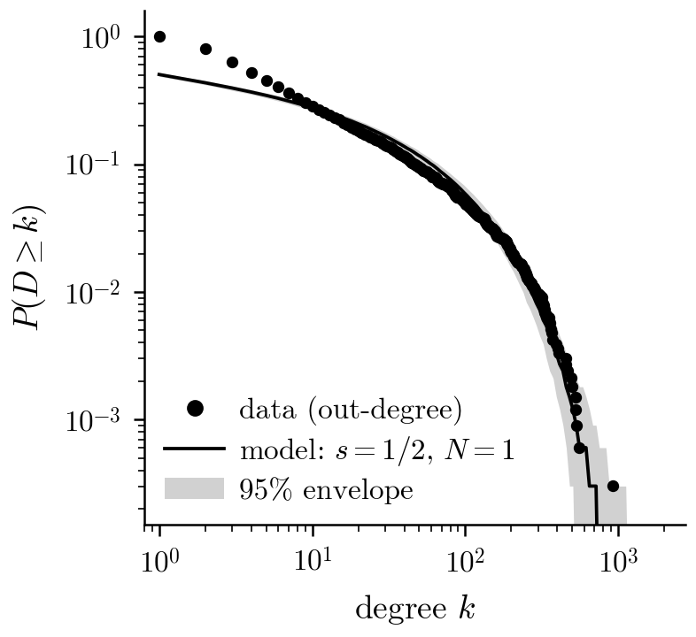

**Figure 6b.** OpenFlights, out-degree, as in Figure 6a.

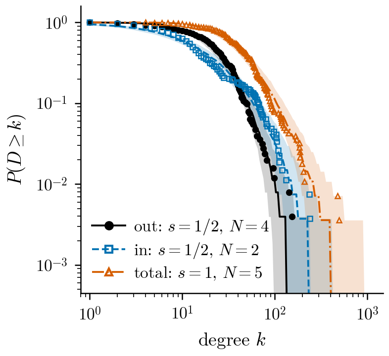

**Figure 6c.** *C. elegans*, the three degree series, as in Figure 6a.

## Estimates for the turbulence record

For squared Gaussian velocity increments, the model with \(s = 1/2\),
\(a = 1/2\), \(N = 1\) is exact, so it is the benchmark here. Intervals
use a moving-block bootstrap; the thinned series keep every \(k\)-th
value to reduce serial dependence.

| Lag (ms) | Variant |      n |  s  |     â | 95% CI (a)  |    N̂ | 95% CI (N)  | N rd |       p |
| -------: | :------ | -----: | :-: | ----: | :---------- | ----: | :---------- | :--: | ------: |
|        2 | full    | 131035 | 1/2 | 0.595 | 0.583–0.607 |  1.28 | 1.24–1.31   |  1   | \<0.001 |
|        2 | thinned |  65519 | 1/2 | 0.591 | 0.575–0.609 |  1.26 | 1.22–1.31   |  1   | \<0.001 |
|        5 | full    | 131043 | 1/2 | 0.503 | 0.494–0.513 | 0.775 | 0.757–0.794 |  1   | \<0.001 |
|        5 | thinned |  26209 | 1/2 | 0.513 | 0.489–0.536 | 0.788 | 0.741–0.833 |  1   | \<0.001 |
|       10 | full    | 131027 | 1/2 | 0.536 | 0.527–0.547 |  1.06 | 1.04–1.09   |  1   |   0.001 |
|       10 | thinned |  13104 | 1/2 | 0.537 | 0.506–0.571 |  1.06 | 0.986–1.15  |  1   |   0.254 |
|       20 | full    | 131029 | 1/2 | 0.491 | 0.482–0.5   | 0.751 | 0.733–0.769 |  1   | \<0.001 |
|       20 | thinned |   6553 | 1/2 | 0.474 | 0.436–0.518 | 0.708 | 0.631–0.797 |  1   |   0.002 |
|       50 | full    | 130989 | 1/2 | 0.522 | 0.513–0.532 |  1.02 | 0.989–1.05  |  1   |   0.354 |
|       50 | thinned |   2620 | 1/2 | 0.499 | 0.435–0.582 | 0.937 | 0.78–1.15   |  1   |   0.578 |
|      100 | full    | 130945 | 1/2 | 0.519 | 0.51–0.529  |  1.02 | 0.99–1.05   |  1   |   0.385 |
|      100 | thinned |   1309 | 1/2 | 0.604 | 0.538–0.689 |  1.22 | 1.04–1.43   |  1   |   0.202 |

Depth estimates with 95% block-bootstrap intervals for the squared
velocity increments, by lag, read from results/analyze\_turbulence.json.
The dashed line marks the Gaussian benchmark N = 1.

At 2, 5 and 20 ms the test rejects \(N = 1\) in the full and the thinned
series, and both intervals for \(N\) exclude one: these increments
depart from the Gaussian benchmark. At 10 ms the full series rejects
(\(p = 0.001\)) but the thinned series does not (\(p = 0.254\)), and the
thinned interval contains one. At 50 and 100 ms neither series rejects,
and the full-sample intervals contain one; at 100 ms the thinned
interval (1.04–1.43, from 1309 values) does not. The estimate is not
monotone in the lag, and compatibility with \(N = 1\) is not the same as
Gaussianity.

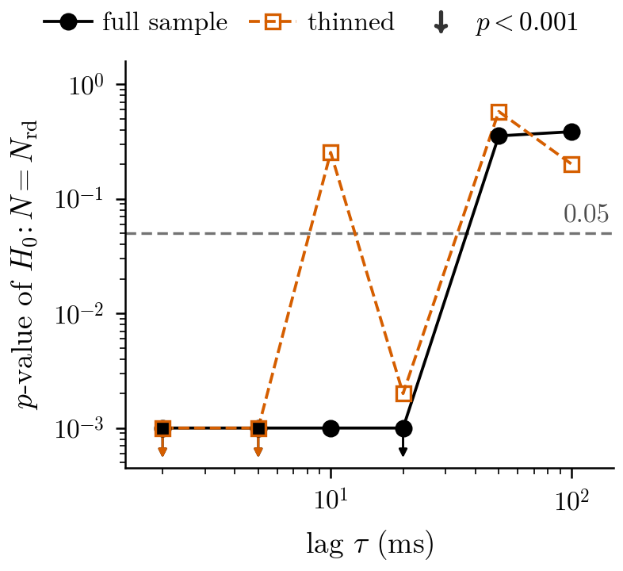

**Figure 6d.** p-value of the bootstrap test of H₀: N = 1 for the
squared velocity increments against the lag, for the full sample and the
thinned series; the dashed line marks 0.05.

## What the results show and what they do not

  - With equal shapes across levels, the class, the shape and the depth
    of a gamma or inverse-gamma cascade are identifiable from the law of
    the innermost temperature, and the same holds for the degrees of the
    hierarchical mixed-Poisson model.
  - The depth test holds its level (rejection rates of 0.02 to 0.09
    under the null) and reaches a power of 0.97 against a two-level
    cascade at \(n = 1000\).
  - The analysis assumes equal shapes. A cascade with unequal shapes
    returns an effective homogeneous depth.
  - No data set here has a known multi-level structure against which an
    estimated depth could be validated. The department labels of
    email-Eu-core are a flat partition, and the geographic levels of
    OpenFlights were not used as a reference.
